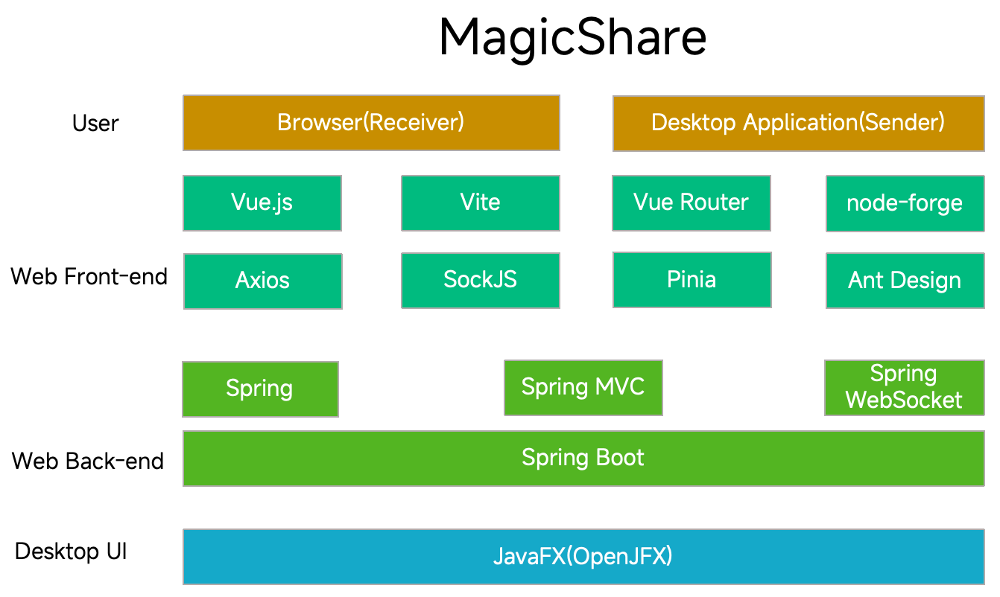

# 神奇分享_**MagicShare**（中文说明）

[**English**](./README_EN.md)

---

Website:

[神奇分享_MagicShare（中文说明） | ZZHow](https://www.zzhow.com/MagicShare)

Source Code:

https://github.com/ZZHow1024/MagicShare

Releases:

https://github.com/ZZHow1024/MagicShare/releases

---

## 它是什么？

MagicShare 是一款跨平台的内网文件分享工具，发送方使用桌面客户端选择需要分享的文件，接收方使用 Web 页面下载分享的文件。

---

## 技术路线



- 编程语言：**Java** 和 **JavaScript**

---

## 许可证

该项目根据 GNU 通用公共许可证 v3.0 获得许可 - 有关详细信息，请参阅 [LICENSE](https://github.com/ZZHow1024/MagicShare/blob/main/LICENSE) 文件。

---

## 用户许可协议

**使用本软件前，请仔细阅读：**

- 合法使用：本软件仅限于合法文件分享，严禁分享任何侵犯版权、涉及色情、暴力、欺诈、违法或其他有害内容的文件。
- 个人责任：您对分享内容的合法性负全部责任，请确保您拥有分享文件的合法授权。
- 风险提示：本软件无法保证所分享文件的安全性，请您自行检查文件的安全性。
- 免责声明：软件作者不对因使用本软件造成的任何直接或间接损失承担责任。

使用 MagicShare 须同意并遵守以上内容。

---

## 使用说明

下载地址：

https://github.com/ZZHow1024/MagicShare/releases

### 桌面客户端

- 确定您使用的操作系统。
    - Linux：
        - 选择 .deb安装包（Debian, Ubuntu） / .rpm（Red Hat, Fedora, SUSE）安装包。
    - macOS：
        - 确定您使用的 Mac 的芯片(Apple Silicon / Intel)。
        - 选择 .dmg磁盘镜像 / .pkg安装包。
    - Windows：
        - 选择 .zip压缩包 / .exe安装包 / .msi安装包。
    - 通用：
        - 选择 .jar包（计算机需要配置好 JRE）
- 下载对应的文件。
- Linux 和 macOS 需要执行安装操作后再运行，Windows 可直接运行 .zip 压缩包中的 .exe 可执行程序或选择 .exe 安装包与 .msi 安装包执行安装操作，.jar 包可直接通过 `java -jar` 命令运行。
- 启动 MagicShare 并认真阅读启动页说明，同意 “用户许可协议” 可继续使用。
- 在 MagicShare 的主界面右下方可以选择语言。
    - 当前支持中文（简体 / 繁体）与英文。
- 选择是否启用连接密码
    - 若希望启用连接密码，需勾选“启用密码”并自定义 3~10 位的密码。
    - 若不希望启用连接密码，需取消勾选“启用密码”。
- 自定义端口后单击 “启动服务” 按钮
    - 若提示 “启动成功”，则表示服务正常启动，可将 ”分享URL“ 提供给接收方。
    - 若提示 ”端口被占用“，请尝试更换端口号。
    - 若提示 “端口号错误”，请检查自定义的端口号是否为 1~65535 的整数。
- 将待分享的文件添加进分享列表中
    - 方式一：拖拽待分享的文件/文件夹至软件主界面上半部分。
    - 方式二：单击 “选择文件夹” 按钮选择待分享的文件夹。
    - 方式三：在 “分享的文件/文件夹” 文本输入框中输入待分享的文件/文件夹路径，按下 “Enter” 键。
- 在软件右上方可查看当前连接数。
- 按下 “停止服务” 按钮可立即终止分享。
- 按下 “清空分享列表” 按钮可立即清空分享列表。

### Web端

- 打开浏览器，访问 ”分享URL“。
- 启动 MagicShare 并认真阅读启动页说明，同意 “用户许可协议” 可继续使用。
- 在 MagicShare 的主界面右下方可以选择语言。
    - 当前支持中文（简体 / 繁体）与英文。
- 下载文件
    - 单击 ”快速下载“ 使用浏览器下载器通过 HTTP 协议快速下载文件。
    - 单击 ”加密下载“ 使用 MagicShare 加密下载器通过 WebSocket 协议并使用 RSA+AES 混合加密下载文件，支持任意大小的文件（64 KB 分块、每块随机 IV）。
    - 勾选多个文件后单击 ”打包下载“ 按钮，可将选中文件打包为 ZIP 一次性下载。
    - 单击 ”在线预览“ 可在浏览器新标签页中直接查看图片、文本、音视频与 PDF 文件，音视频支持拖动进度。
- 单击 “查看加密下载进度” 按钮，页面下方将弹出加密下载进度抽屉。

### Web 上传

- 上传功能需在桌面客户端勾选 “允许接收文件” 后启动服务方可使用，接收的文件保存到 “接收目录”（默认为系统下载目录，即 Windows/macOS/Linux 下的 用户目录/Downloads，可通过接收目录右侧的 “选择文件夹” 按钮修改）。
- 标准分享模式
    - 打开浏览器，访问 “分享URL”，在 “上传文件” 区域单击或拖拽文件即可上传。
    - 支持多文件队列与逐文件进度显示。
    - 大文件自动按 4 MB 分片上传，页面刷新后重新选择同一文件可从已传分片处继续。
- 简单分享模式
    - 访问 “分享URL”，在页面下方的上传表单中选择文件后单击 “Upload”。
    - 命令行上传：`curl -F "file=@本地文件" 分享URL/upload`。
- 上传完成的文件不会自动加入分享列表。

### 简单分享模式

- 简单分享模式不依赖 Vue 前端，适用于古老浏览器、wget/curl 等命令行工具，以及类似 Nginx 共享目录的轻量文件列表场景。
- 启用方式
    - 启动服务前，在桌面客户端单击 “简单分享” 按钮切换模式（服务运行期间不可切换）。
    - 可勾选 “显示目录结构”：勾选后按目录树浏览分享根目录；取消勾选则平铺展示已添加的分享文件。
    - 简单分享模式不支持连接密码。
- 启动服务后，接收方访问 “分享URL” 即可看到纯 HTML 文件列表（文件名、大小、修改时间、下载链接）。
- 目录页的 “ZIP” 链接可将当前目录（含子目录）打包下载为 ZIP 文件，例如 `wget "分享URL/zip/目录名"`。
- 在 URL 后追加 `?inline=true` 可在浏览器中直接预览文件（图片、文本、音视频、PDF），例如 `curl -O "分享URL/文件?inline=true"`。
- 下载文件
    - 浏览器：单击文件链接直接下载。
    - 命令行：`wget --content-disposition "文件URL"` 或 `curl -OJ "文件URL"`。
    - 支持 HTTP Range 断点续传：`wget -c "文件URL"` 或 `curl -C - -O "文件URL"`。
- 在 URL 后追加 `?checksum=true` 可在列表中显示每个文件的 SHA-256 校验和。

---

## 开发环境

- 前端（frontend 目录）：需要 Node.js 与 pnpm。

    ```
    cd frontend
    pnpm install
    pnpm dev     # 热更新开发，API 与 WebSocket 自动代理到本机服务
    pnpm build   # 独立构建（产物在 dist 目录）
    ```

- 后端与桌面客户端（backend 目录）：需要 JDK 21 与 Maven。

    ```
    cd backend
    mvn javafx:run            # 启动桌面客户端（内嵌后端服务）
    mvn package               # 一体化打包：自动构建前端并产出可执行 Jar（java -jar 直接运行）
    ```

- 版本号单一来源为 backend/pom.xml：打包时自动注入桌面关于页（version.properties）与 Web 关于页（VITE_APP_VERSION）。

---

## 依赖项

该项目需要以下库：

- [**Vue.js**](https://github.com/vuejs)** 及配套组件**：**用于构建 Web 前端程序。
- [**Spring Boot**](https://github.com/spring-projects/spring-boot)** 及配套组件：用于构建 Web 后端程序。
- [**OpenJFX**](https://openjfx.io/)：用于构建图形用户界面的 JavaFX 库。

---

## 各版本功能介绍

- MagicShare1.0.0
    - 自定义端口启动服务。
    - 按文件夹/文件路径查找文件并生成列表。
    - Web 网页下载文件。
        - 支持通过 HTTP 协议快速下载文件
        - 支持通过 WebSocket 协议并使用 RSA+AES 混合加密下载文件
- MagicShare2.0.0
    - 当前连接数显示。
    - 自定义连接密码。
    - 支持多语言。
        - 中文（简体/繁体）
        - 英文
- MagicShare3.0.0
    - 简单分享模式：不依赖 Vue 前端，支持 wget/curl 与老浏览器访问，支持目录打包下载与文件在线预览。
    - Web 上传：接收方可通过浏览器或 curl 向分享端发送文件，支持大文件分片与断点续传。
    - 打包下载与在线预览：多选文件打包为 ZIP 下载，浏览器直接预览图片、文本、音视频与 PDF。
    - 加密传输升级：每消息随机 IV、标准化 RSA-OAEP（SHA-256）、密码认证随机挑战防重放、加密下载支持任意大小文件并大幅提升分块效率。

---

## 各版本主界面

### MagicShare2.0.0


MagicShare2.0.0-Desktop-ZH


MagicShare2.0.0-Web-ZH

### MagicShare1.0.0


MagicShare1.0.0-Desktop


MagicShare1.0.0-Web
